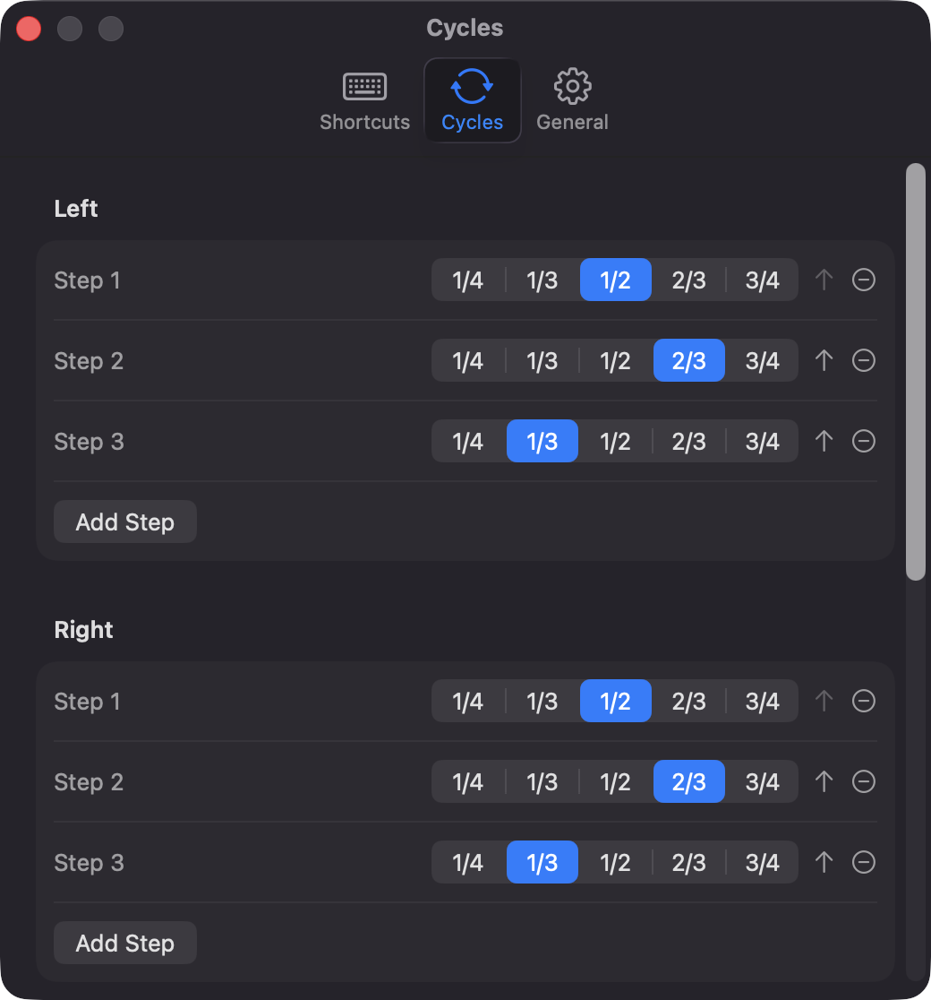
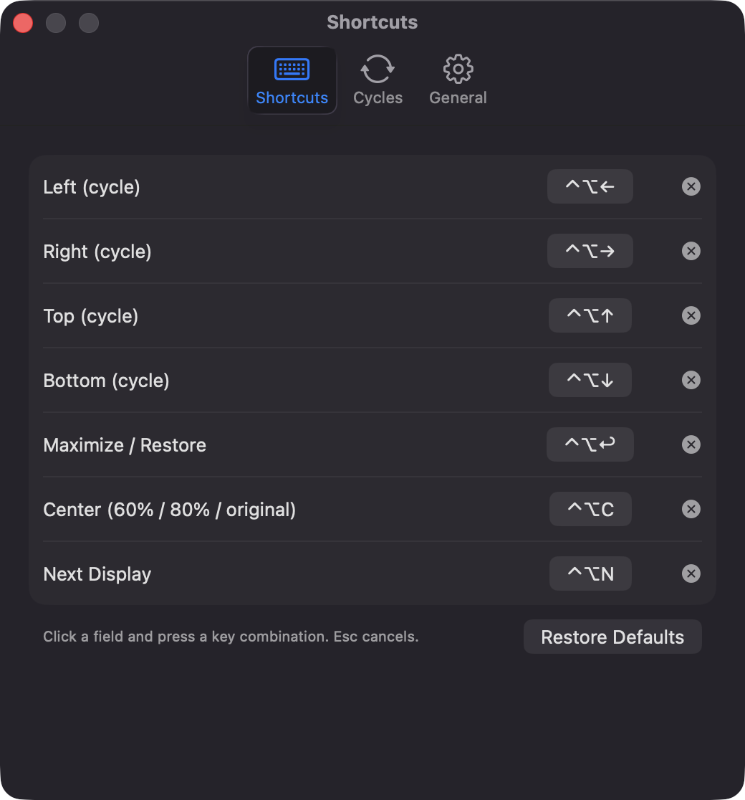
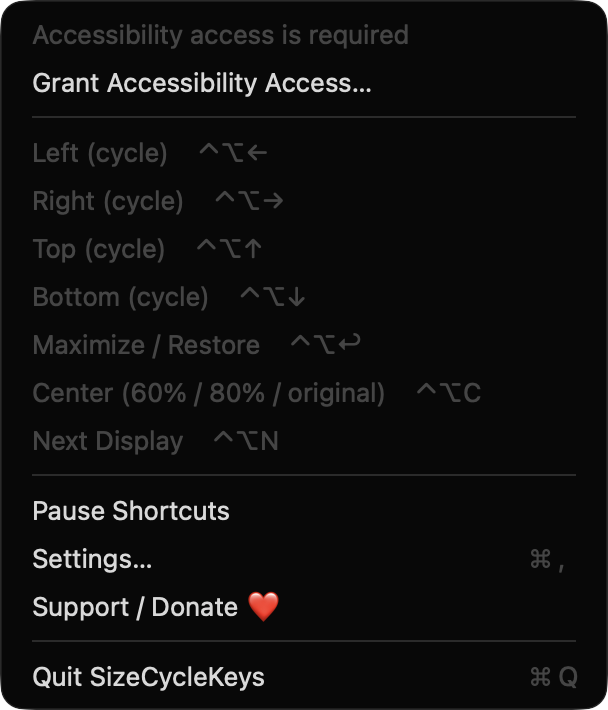

# SizeCycleKeys

**🌐 Website:** [turhe123.github.io/size-cycle-keys](https://turhe123.github.io/size-cycle-keys/)

Press one hotkey repeatedly to cycle a window through half, two-thirds and one-third widths, edge by edge.

> 🆓 A free, open-source **SizeUp alternative** for macOS 14+. Native Swift, no accounts, no subscriptions, MIT licensed.


## Why

SizeCycleKeys is a free, open-source, 100% native, backend-free alternative to paid utilities in the *Window Management* category. It was inspired by SizeUp ($12.99 one-time), whose idea of cycling sizes with repeated presses is a great fit for keyboard-centric workflows. SizeCycleKeys focuses on that idea: one shortcut per direction walks through several sizes, so you need very few shortcuts. It is built with SwiftUI and AppKit only, has no network access, no analytics and no third-party dependencies.

## Features

- **Cycling edge hotkeys**: Left, Right, Top and Bottom. Press the same hotkey again within the timeout and the window steps through the cycle (default: 1/2 → 2/3 → 1/3, then back to 1/2).
- **Editable cycles**: each direction has its own ordered list of up to 6 steps, chosen from 1/4, 1/3, 1/2, 2/3 and 3/4.
- **Maximize / Restore**: toggles between the maximized frame and the window's previous frame.
- **Center**: cycles 60%, 80% and back to the window's original size.
- **Next Display**: moves the window to the next screen, keeping its relative position and size.
- **Multi-display aware**: fractions are taken from the visible frame (excluding menu bar and Dock) of the display the window mostly sits on.
- **Smart cycling**: a repeat only advances if the window is still where the app last put it; otherwise the cycle restarts. If a window's minimum size prevents a step, the app skips to the next one.
- **Gap setting**: 0–40 pt of spacing between windows and screen edges.
- **Layout HUD**: a small, transient overlay shows the layout name (for example "Left 2/3"). It can be turned off.
- **Menu bar app**: every action and its hotkey are listed in the menu for mouse use, plus Pause Shortcuts, Settings, Support and Quit.
- **Shortcut recorder**: record your own key combinations, with warnings for likely macOS system conflicts and for duplicates within the app.
- **Configurable reset timeout**: 0.5–5 seconds.
- **Launch at login** via `SMAppService`.
- **Safe behavior**: full-screen windows are skipped, non-resizable windows are only moved, and Option-only shortcuts are ignored while you are typing in a text field.

### Default shortcuts

| Action | Shortcut |
| --- | --- |
| Left / Right / Top / Bottom (cycle) | ⌃⌥← / ⌃⌥→ / ⌃⌥↑ / ⌃⌥↓ |
| Maximize / Restore | ⌃⌥↩ |
| Center | ⌃⌥C |
| Next Display | ⌃⌥N |

## Screenshots

<p align="center"></p>

<p align="center"><em>The Cycles editor: each edge hotkey steps through its own ordered list of widths, 1/2 → 2/3 → 1/3 by default.</em></p>

<p align="center"></p>

<p align="center"><em>Every action has a recordable global shortcut, defaulting to Control-Option plus an arrow, Return, C or N.</em></p>

<p align="center"></p>

<p align="center"><em>The menu bar menu lists every action with its hotkey until Accessibility access is granted, it shows a Grant button and the actions stay disabled.</em></p>

## Install

1. Download `SizeCycleKeys-macOS.zip` from the [latest release](https://github.com/turhe123/size-cycle-keys/releases/latest).
2. Unzip it and move `SizeCycleKeys.app` to `/Applications`.
3. The app is open source and not notarized, so clear the quarantine attribute:

   ```bash
   xattr -cr /Applications/SizeCycleKeys.app
   ```

4. The first time, right-click the app and choose **Open**.

## Build from source

Requires macOS 14+ and Xcode with Swift 5.9+.

```bash
brew install xcodegen
xcodegen generate
xcodebuild -project SizeCycleKeys.xcodeproj -scheme SizeCycleKeys -configuration Release -derivedDataPath ./build build
```

The app is produced at `build/Build/Products/Release/SizeCycleKeys.app`.

## Permissions

- **Accessibility** (required): used to read the focused window's position and size and to move and resize it. Without it, hotkeys are disabled and the menu shows a "Grant Accessibility Access…" button. It is also used to check whether a text field has focus, so Option-only shortcuts don't interfere with typing.

SizeCycleKeys does **not** request Screen Recording, Microphone, Camera, Location, or network access, and the source contains no code that uses them.

## Support ❤️

SizeCycleKeys is free and always will be. If it saves you time, you can support its development:

[%20Davidai%20%E2%9D%A4%EF%B8%8F-ff5e5b?logo=ko-fi&logoColor=white)](https://ko-fi.com/leodavidai)

[Support Or (Leo) Davidai ❤️](https://ko-fi.com/leodavidai)

## More free Mac apps

SizeCycleKeys is one of [60 free, open-source Mac utilities](https://github.com/turhe123/mac-apps) built the same way: native Swift, no accounts, no telemetry. Browse the full gallery at [turhe123.github.io/mac-apps](https://turhe123.github.io/mac-apps/).

## License

MIT © Or Davidai Bachar
